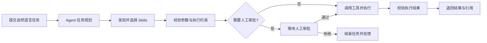

# AegisFlow

**面向企业业务自动化场景的 AI Agent 与 Skills 工作流平台。**

AegisFlow 计划让用户通过自然语言发起任务，由 Agent 完成任务规划、技能发现、工具调用和结果反馈，并提供人工审批、状态恢复、执行追踪与评测能力。

> **项目状态：规划阶段。** 以下功能、技术栈和目录结构是项目设计目标，当前仓库尚未包含可运行的实现。

## 目录

- [项目简介](#项目简介)
- [核心功能](#核心功能)
- [技术栈](#技术栈)
- [工作流程](#工作流程)
- [项目结构](#项目结构)
- [快速开始](#快速开始)
- [开发计划](#开发计划)
- [贡献](#贡献)
- [许可证](#许可证)

## 项目简介

企业业务流程往往涉及多个系统、复杂规则和需要人工确认的操作。AegisFlow 希望通过状态化 Agent 工作流，把自然语言任务转化为可追踪、可控制的执行步骤，并通过可复用的 Skills 接入业务能力。

## 核心功能

以下能力均为规划内容：

- **任务规划与执行**：将自然语言需求拆解为任务步骤，执行并返回结果。
- **Skills 管理**：统一描述技能、输入输出和执行约束，支持注册、发现、参数校验与调用。
- **工具集成**：通过 MCP 协议接入外部工具和业务系统。
- **人工审批**：对高风险操作进行权限检查，并在需要时等待人工确认。
- **状态恢复**：持久化工作流状态，结合检查点和幂等机制降低中断及重复执行的影响。
- **知识检索**：通过文档处理、检索和上下文组装，为 Agent 提供知识支持并返回引用。
- **追踪与评测**：记录模型响应、工具调用、工作流节点和错误，评估任务执行与异常恢复情况。

## 技术栈

| 层级 | 计划使用 | 职责 |
| --- | --- | --- |
| 前端 | React、TypeScript、Vite | 任务交互与执行状态展示 |
| 后端 | Python、FastAPI、Pydantic | API、业务逻辑与数据校验 |
| Agent 与工具 | LangGraph、MCP | 工作流编排与外部工具接入 |
| 数据与缓存 | PostgreSQL、Redis | 数据持久化与缓存 |
| 部署 | Docker | 容器化运行 |

## 工作流程



知识检索可在需要时为任务提供上下文。执行过程中计划记录状态和调用信息，并通过检查点支持恢复。

## 项目结构

项目计划采用单仓库管理前后端，目录结构预计如下；这些目录尚未创建：

```text
AegisFlow/
├── frontend/           # React + TypeScript 前端
├── backend/            # FastAPI + Python 后端
├── docs/               # 项目设计与开发文档
├── docker-compose.yml  # 本地服务编排
└── README.md
```

前后端将分别管理依赖和构建流程，也可以独立部署。

## 快速开始

项目尚处于规划阶段，工程代码、环境要求和启动步骤完成后将在此补充。

## 开发计划

- [ ] 建立前后端基础工程与开发环境
- [ ] 实现任务提交与状态化 Agent 工作流
- [ ] 建立 Skills 注册、发现和执行机制
- [ ] 接入 MCP 工具与参数校验
- [ ] 实现权限检查、人工审批与状态恢复
- [ ] 接入知识检索和引用返回
- [ ] 完善执行追踪、评测与自动化测试
- [ ] 提供容器化部署与使用文档

## 贡献

项目仍在规划中，贡献流程将在工程初始化后补充。

## 许可证

尚未选择许可证；确定后将在仓库中添加许可证文件。
